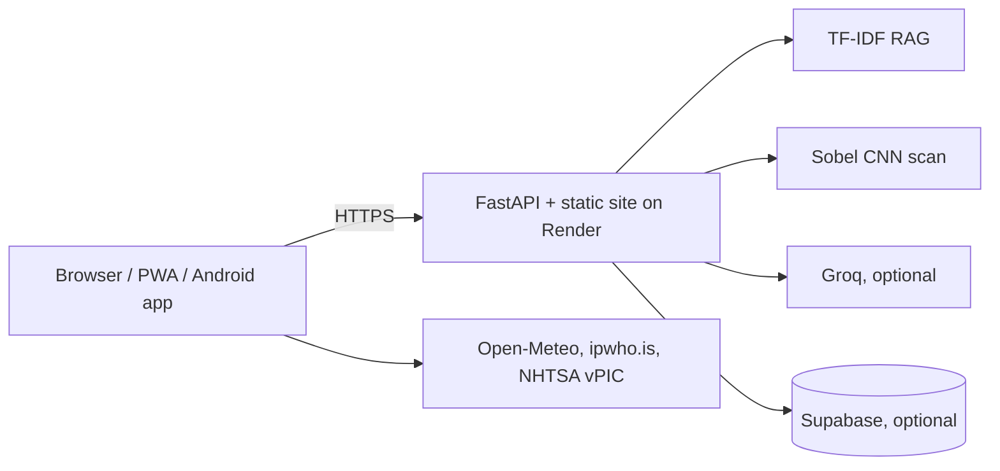

# Garage
3D driving sim + AI backend. Built by Nikhil Chary Sriramoju.
- Run `sh get-vendor.sh` once to bundle three.js locally (recommended).
- Static only: open `web/index.html` via any static server (`cd web && python3 -m http.server`).
- Full stack: `docker compose up --build` then http://localhost:8000
- Agent + RAG + CNN endpoints: `/api/agent`, `/api/cnn`, `/api/health`.
- Vercel/Netlify serve `web/` only (coach falls back offline). Render runs the Docker image (full backend).

## Persistent leaderboard (optional, free Supabase)
Run once in the Supabase SQL editor:
`create table scores(id bigint generated always as identity primary key, name text, score int, dist int, coins int, created_at timestamptz default now()); alter table scores enable row level security;`
Then set `SUPABASE_URL` and `SUPABASE_KEY` (service_role key) in Render. Keep the key server-side only.

## Architecture

## Android APK
GitHub, Actions, android-apk, Run workflow. Download the `garage-apk` artifact and install it. The app calls the Render backend.
